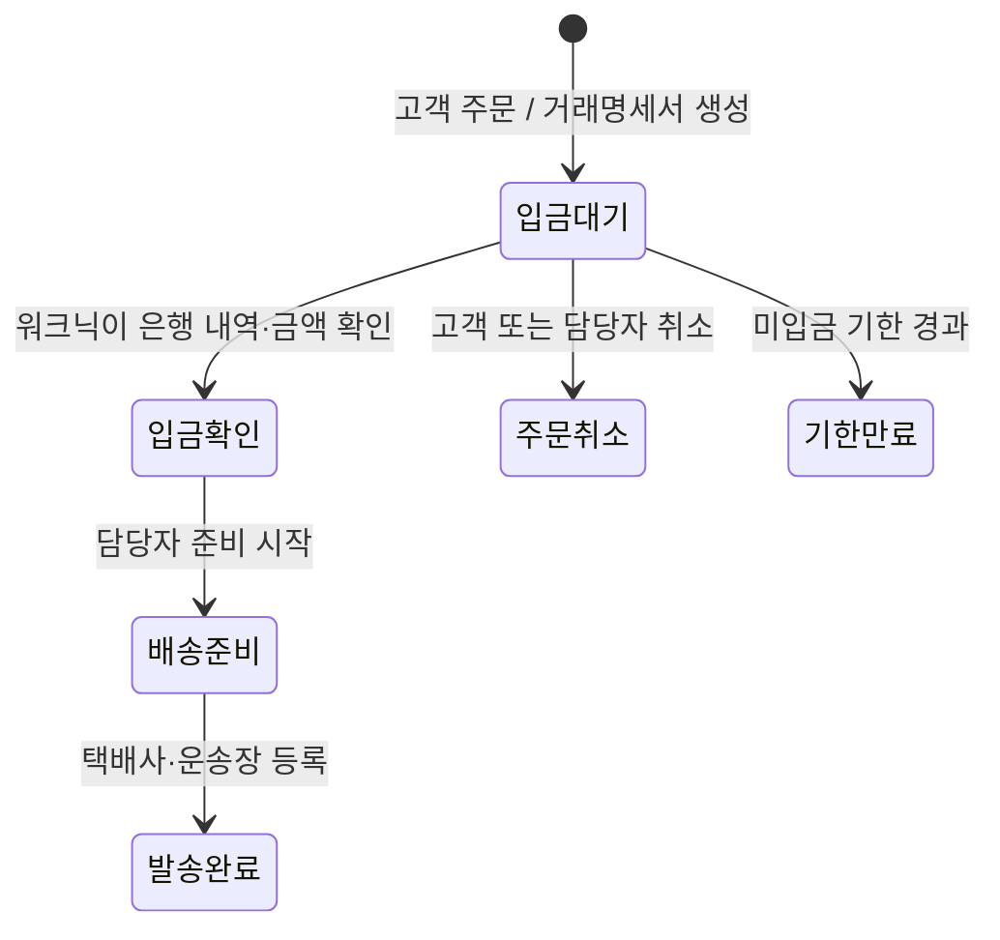

# 데이터와 업무 구조

## 역할과 화면

- 고객: `/trade/`에서 가입·로그인, 승인 후 가격 조회·장바구니·주문, 본인 주문 내역과 거래명세서 조회·인쇄.
- 담당자: `/trade/admin`에서 사업자 승인·거래 정지, 상품 단가·수량 설정, 입금 확인·배송 준비·운송장 등록, 계좌·배송비·접수 설정.
- 1차 버전은 담당자 로그인 계정별 주문 조회입니다. 한 회사의 여러 담당자가 주문을 공유하는 조직·초대 기능은 아직 포함하지 않습니다.

## 주문 상태

입금확인 이후의 취소·환불·반품은 담당자가 별도로 응대합니다. 만료·취소 주문을 입금완료로 바꾸는 기능은 없습니다. 이미 입금된 주문을 미입금 취소로 처리하지 않습니다. 자동입금 감지나 자동발송은 하지 않습니다.

## 가격·수량·명세서

- 모든 가격은 원 단위 정수이며 **부가세 포함**입니다. 서버가 단가와 배송비를 계산하고 고객 화면의 예상 금액과 대조합니다. 변경되었다면 주문을 중단하고 재확인을 요청합니다.
- 상품금액 500,000원부터 배송·포장비 0원, 미만 5,000원. 수량·배송비는 상품금액 합계를 기준으로 계산합니다.
- 주문 시 판매 가능한 수량을 예약·차감합니다. 취소·기한 만료 시 한 번만 복원합니다. 입금 확인·발송에서는 다시 차감하지 않습니다.
- 주문번호·입금기한과 상품·공급자·구매자·계좌·금액 스냅샷을 하나의 DB 트랜잭션으로 생성합니다. 이후 상품 가격·계좌 변경은 과거 명세서를 바꾸지 않습니다.
- 명세서는 서버의 주문 스냅샷을 이용해 조회 시 생성하며 인쇄·PDF 저장을 지원합니다. 이메일 자동 발송, 전자세금계산서 발행은 없습니다.
- 공급가액·부가세는 배송·포장비 포함 합계를 기준으로 부가세 `반올림(합계 / 11)`, 공급가액 `합계 - 부가세`로 분리합니다. 세금계산서 발행은 별도 회계 절차입니다.

## 보관 모델

| 테이블 | 내용 |
| --- | --- |
| members | 고객·담당자 계정, scrypt 암호 해시, 사업자·배송 정보, 승인 상태, 동의 시점 |
| sessions | 세션 토큰 해시와 만료 시각. HttpOnly·SameSite 쿠키 사용 |
| products | 카탈로그 정보, 부가세 포함 단가, 주문 가능 수량, 판매·특수배송 설정 |
| orders | 고객 ID, 주문번호, 중복 방지 키, 주문 당시 스냅샷, 입금·발송 담당자와 시각 |
| settings | 계좌, 배송·포장비, 무료배송 기준, 입금기한, 주문 접수 상태 |
| audit | 회원 승인·가격·주문·설정 변경 기록 |
| resets | 30분 일회용 암호 재설정 토큰 해시 |
| limits | 로그인·가입 요청 제한용 키 해시와 만료 시각 |

고객 주문은 다른 고객 계정에서 조회할 수 없습니다. 결제 상태 변경·배송 준비·발송·계좌 설정·회원 승인은 서버에서 담당자 권한을 확인합니다. 주문·관리자 세션은 역할별 만료시간이 다르고, 거래 정지·암호 재설정 시 기존 세션을 폐기합니다.

## 이후 확장

카탈로그 자동 주기 동기화, 조직별 담당자 공유, 제주·도서산간 주소 자동 판정과 추가배송비, 배송 조회 API, 은행 입금 연동, 전자세금계산서, PG 카드결제를 기존 주문 모델 위에 추가할 수 있습니다. 현재 카탈로그 동기화는 담당자가 버튼을 눌러 실행합니다. 나머지 후속 기능은 현재 구현된 것으로 표시하지 않습니다.
